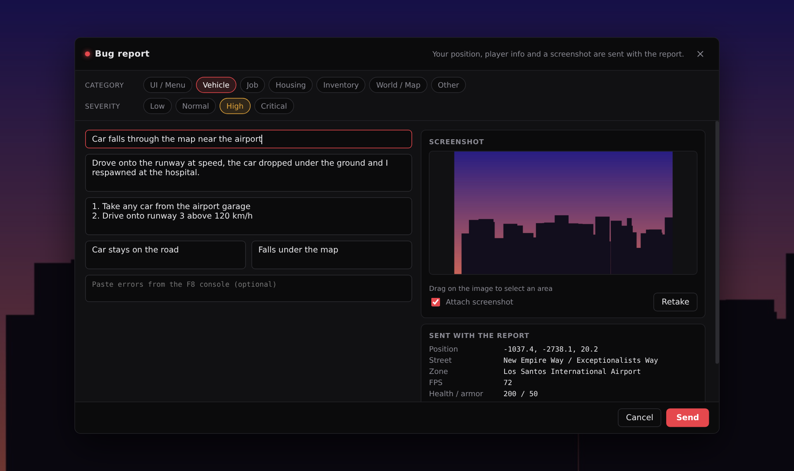

# ziks-bugreport

Free in-game bug reports for FiveM, delivered to a **Discord webhook**.

Players press **F9** (or type `/bug`), describe the problem, crop a screenshot, and send it. Your Discord channel gets a clean embed with the screenshot and a report file that holds everything you need to reproduce the bug.



## Features
- **Screenshot with crop:** captured without the UI on top. Players can drag to select the important area. Original quality is kept.
- **Full context, collected automatically:**
  - position, street, zone, interior, vehicle, health and armor
  - FPS, ping, resolution, game time and weather
  - what the player is looking at, and the nearest vehicle
  - job, gang, money and inventory (QBCore, Qbox, ESX or ox_inventory)
  - recent **server console errors** and the last console lines
  - started resources with versions, plus resources that failed to start
  - the full player data as a JSON file (IP addresses are never included)
- **F8 paste box:** clients can't read F8 errors from Lua, so players can paste them.
- **Discord forum mode:** every report becomes its own forum post. Tag it, discuss it and close it, like a lightweight bug tracker.
- **Role pings** for `high` and `critical` reports.
- **Severity control:** only players with an ACE permission can pick a severity. Everyone else sends `normal`.
- **Anti-spam:** cooldown and hourly cap per player.
- **Reliable delivery:** respects Discord rate limits and retries. If Discord is down, reports are saved to `queue.json` and sent later. Oversized attachments are dropped in order, so the embed always arrives.
- **Safe by design:** the webhook URL lives in a server-only convar and never reaches clients. Player text can't ping `@everyone`.
- **Standalone:** no ox_lib needed. Works with **QBCore, Qbox, ESX or no framework**.
- English and Russian included. Add a language in `config.lua`.

## Requirements
- [screenshot-basic](https://github.com/citizenfx/screenshot-basic) (or [screencapture](https://github.com/itschip/screencapture), which provides it)
- A FiveM server artifact with Node.js server scripts (every recent artifact)

## Install
1. Download this repo and put the folder in `resources/` as `ziks-bugreport`.
2. In Discord: **Channel settings → Integrations → Webhooks → New Webhook → Copy Webhook URL**.
3. Add to `server.cfg`:
   ```cfg
   ensure screenshot-basic
   ensure ziks-bugreport

   # server-only: use `set`, NOT `setr`
   set ziks_bugreport_webhook "https://discord.com/api/webhooks/XXXXXXXX/YYYYYYYY"

   # who may choose a severity (optional)
   add_ace group.admin ziks-bugreport.severity allow
   ```
4. Restart the server. The console prints `webhook OK: "<name>" -> channel <id>`.

## Configuration (`config.lua`)
| Option | Default | |
|---|---|---|
| `Locale` | `'en'` | `'en'` or `'ru'` |
| `Key` / `Command` | `F9` / `bug` | Players can rebind the key in GTA settings |
| `Cooldown` / `HourlyCap` | `120` / `6` | Per player |
| `SeverityAce` / `SeverityForAll` | `ziks-bugreport.severity` / `false` | Who can pick a severity |
| `PingRoles` | empty | Role IDs to ping for `critical` / `high` |
| `Forum` / `ForumTags` | `false` / empty | Post every report as a forum thread, with optional tag IDs per severity |
| `Attach.*` | all `true` | Toggle the screenshot, report file, player JSON, inventory, console and resource list |
| `Categories` | 7 categories | Your own categories and labels |

### Forum mode (recommended)
1. Create a **Forum** channel, for example `#bug-reports`, with tags such as `Open`, `Fixed` and `Critical`.
2. Create the webhook on that forum channel.
3. Set `Config.Forum = true`. Optionally map tag IDs in `Config.ForumTags` (right-click a tag → Copy ID, with Developer Mode on).

Each report now opens its own post, titled `[High] Car falls through the map`.

## Privacy
Reports go only to your webhook; nothing is sent anywhere else. Reports include the player's name, Discord ID, license and character data, but never IP addresses. Turn off anything you don't want in `Config.Attach`. Tell your players in your rules that bug reports include this data.

## Coming next
**ziks Dev Hub:** a free hosted board with kanban, Discord `/bug` commands, tester roles and releases. `ziks-bugreport` will be able to send reports to the board instead of a webhook.

## Links
- More scripts: **[fivem.ushpuras.dev](https://fivem.ushpuras.dev)**
- Issues and ideas: [GitHub Issues](https://github.com/ziks29/ziks-bugreport/issues)

## License
MIT © ziks
